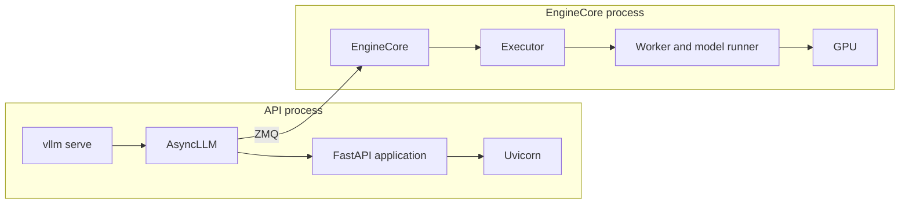
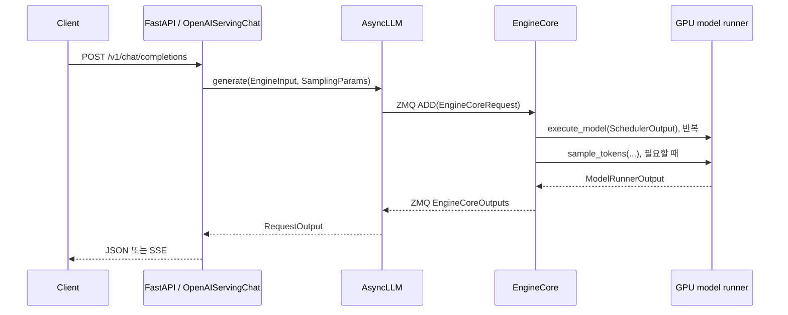

# vLLM v0.32.0: 서버 시작부터 요청 완료까지 코드로 따라가기

## 분석 범위와 읽는 순서

분석 기준 revision은 `v0.32.0`의
`5df63a7203cdb9328d824a27b682e77c7b9928be`이다. 아래 링크는 모두 이 commit에
고정했다.

범위는 Python frontend, 단일 API 서버, data parallel 크기 1, GPU 하나인 일반 경로다.
`--headless`, gRPC, Rust frontend, 다중 API 서버는 이 경로를 바꾼다. 모델과
GPU를 지정하지 않았으므로 특정 모델 class나 CUDA kernel은 분석 대상이 아니다.

이 문서는 소스 분석 결과다. 모델 다운로드, 서버 실행, GPU 추론 검증은 하지 않았다.
서버 시작을 먼저 따라가고, 그 뒤 `POST /v1/chat/completions` 요청 하나를 끝까지 추적한다.
코드 발췌는 주변 분기와 부가 인자를 생략한 읽기용이며, 독립 실행 예제가 아니다.

시작 경로는 다음과 같다.



API process는 HTTP와 frontend 상태를 가진다. EngineCore process는 scheduler와
model execution을 가진다. 기본 `uni` executor에서는 worker가 EngineCore 안의
객체다. 이 경우 worker process가 하나 더 생기지는 않는다.

앞의 1~11절은 서버 시작 과정이다. 이어지는 요청 처리 절은 같은 서버가 받은
요청 하나의 수명을 설명한다. 실행 환경 확인 명령은 마지막 부록에 모았다.

## 1. 콘솔 명령은 `cli.main:main`에서 `serve` subcommand를 고른다

`pyproject.toml`은 `vllm` console script를
[`vllm.entrypoints.cli.main:main`](https://github.com/vllm-project/vllm/blob/5df63a7203cdb9328d824a27b682e77c7b9928be/pyproject.toml#L42-L43)에
연결한다. `main`은 argument parser로 subcommand를 고른 뒤
`ServeSubcommand.cmd(args)`를 호출한다.

이 문서의 핵심 분기는
[`vllm/entrypoints/cli/serve.py:65-156`](https://github.com/vllm-project/vllm/blob/5df63a7203cdb9328d824a27b682e77c7b9928be/vllm/entrypoints/cli/serve.py#L65-L156)에
있다. 이 함수는 model positional argument를 반영한 뒤 gRPC, headless, Rust
frontend, data parallel load balancing을 구분한다.

다음 두 발췌는 원본의 서로 떨어진 분기다. 중간의 load balancer 판단은
생략했다.

```python
if args.api_server_count is None:
    if is_multi_port or is_external_lb or rust_frontend_path:
        args.api_server_count = 1
    elif is_hybrid_lb:
        args.api_server_count = args.data_parallel_size_local or 1
    else:
        args.api_server_count = args.data_parallel_size
```

```python
if is_multi_port:
    run_dp_supervisor(args)
elif args.api_server_count < 1:
    run_headless(args)

elif args.api_server_count > 1 or rust_frontend_path:
    run_multi_api_server(args)
else:
    args.api_server_count = None
    uvloop.run(run_server(args))
```

`api_server_count`를 지정하지 않고 `data_parallel_size == 1`이면 마지막
`else`로 들어간다. 이때 `None`은 단일 API server process라는 뜻이다. data
parallel 크기가 2 이상이면 기본 API server 수도 그 크기와 같아져
`run_multi_api_server` 경로가 선택된다.

## 2. `run_server`는 listen 전에 socket을 bind하고 worker를 호출한다

`run_server`는
[`entry.py:165-178`](https://github.com/vllm-project/vllm/blob/5df63a7203cdb9328d824a27b682e77c7b9928be/vllm/entrypoints/launchers/api_server/entry.py#L165-L178)에
있다. 이 함수는 API server 로그 label을 설정한다. 또한 Uvicorn이 signal
handler를 설치하기 전 `SIGTERM`이 오면 초기화를 중단하는 임시 handler를
설치한다.

다음 코드는 실제 호출을 남긴 발췌다.

```python
listen_address, sock = setup_server(args, reuse_port=False)
await run_server_worker(listen_address, sock, args, **uvicorn_kwargs)
```

`setup_server`는
[`launchers/launcher.py`](https://github.com/vllm-project/vllm/blob/5df63a7203cdb9328d824a27b682e77c7b9928be/vllm/entrypoints/launchers/launcher.py)
에 있다. 이 함수는 버전과 비기본 인자를 로그에 남기고 parser plugin을
import하며 인자를 검증한다. 이어 `create_server_socket`으로 socket을
`bind()`한다. 그 다음 file-descriptor limit을 설정하고 `(listen_address,
sock)`를 반환한다.

`create_server_socket`의
[bind 코드](https://github.com/vllm-project/vllm/blob/5df63a7203cdb9328d824a27b682e77c7b9928be/vllm/entrypoints/launchers/launcher.py#L335-L350)는
socket에 주소를 연결할 뿐 요청을 받지 않는다. HTTP serve loop는 나중에
`serve_http`가 이 socket을 Uvicorn에 전달할 때 시작한다. 따라서 포트 bind
실패와 model initialization 실패는 서로 다른 시작 단계의 오류다.

## 3. `run_server_worker`가 plugin, engine, socket 수명을 관리한다

`run_server_worker`는
[`entry.py:180-207`](https://github.com/vllm-project/vllm/blob/5df63a7203cdb9328d824a27b682e77c7b9928be/vllm/entrypoints/launchers/api_server/entry.py#L180-L207)에
있다. 이 함수는 지정된 tool parser와 reasoning parser plugin을 import한다.
여러 API process가 같은 engine을 공유하면 `client_config`에서 peer load
counter도 읽는다.

아래는 engine context와 정상 종료 시 정리 구조를 남긴 발췌다.

```python
async with build_async_engine_client(
    args, client_config=client_config
) as engine_client:
    shutdown_task = await build_and_serve(
        engine_client, listen_address, sock, args, peer_loads, **uvicorn_kwargs
    )
try:
    await shutdown_task
finally:
    sock.close()
```

`await build_and_serve(...)`는 server가 실행되는 동안 반환하지 않는다.
`serve_http`가 만든 server task가 종료 또는 취소된 뒤 cleanup awaitable을
반환한다. 그 후 `async with`를 빠져나가면서 engine context가 shutdown된다.
마지막으로 `shutdown_task`를 await하고 socket을 닫는다. 즉 API server가
실행 중인 동안 engine client는 context 안에 유지된다.

## 4. `Namespace`는 `AsyncEngineArgs`를 거쳐 `VllmConfig`가 된다

`build_async_engine_client`는
[`entry.py:36-68`](https://github.com/vllm-project/vllm/blob/5df63a7203cdb9328d824a27b682e77c7b9928be/vllm/entrypoints/launchers/api_server/entry.py#L36-L68)에서
CLI `Namespace`를 `AsyncEngineArgs`로 바꾼다. 여러 API process가 있을 때는
여기서 API process count와 rank도 넣는다.

```python
engine_args = AsyncEngineArgs.from_cli_args(args)
# API process 정보 설정 생략
async with build_async_engine_client_from_engine_args(
    engine_args, usage_context=usage_context, client_config=client_config
) as engine:
    yield engine
```

`build_async_engine_client_from_engine_args`는
[`entry.py:70-114`](https://github.com/vllm-project/vllm/blob/5df63a7203cdb9328d824a27b682e77c7b9928be/vllm/entrypoints/launchers/api_server/entry.py#L70-L114)에
있다. 여기서 `create_engine_config`는 model, cache, parallel, scheduler,
device 설정을 `VllmConfig`로 묶는다. 설정 validation이 먼저 완료된 뒤
`AsyncLLM.from_vllm_config`를 무조건 호출한다.

```python
vllm_config = engine_args.create_engine_config(
    usage_context=usage_context
)
async_llm = AsyncLLM.from_vllm_config(
    vllm_config=vllm_config,
    # Remaining keyword arguments omitted.
)
```

engine 생성에 실패하면 아직 FastAPI application을 만들지 않았으므로 HTTP
route는 준비되지 않는다. context의 `finally`에서는 생성된 `async_llm`에
`shutdown(timeout=vllm_config.shutdown_timeout)`을 호출한다.

## 5. `AsyncLLM`은 frontend 변환기와 EngineCore client를 만든다

`AsyncLLM.__init__`의
[초기화 코드](https://github.com/vllm-project/vllm/blob/5df63a7203cdb9328d824a27b682e77c7b9928be/vllm/v1/engine/async_llm.py#L145-L192)는
다음 순서다. 아래는 인자 일부를 생략한 실제 줄의 발췌다.

```python
self.renderer = renderer = renderer_from_config(self.vllm_config)
self.input_processor = InputProcessor(self.vllm_config, renderer)
self.output_processor = OutputProcessor(
    renderer.tokenizer,
    # Remaining keyword arguments omitted.
)
self.engine_core = EngineCoreClient.make_async_mp_client(
    vllm_config=vllm_config,
    executor_class=executor_class,
    # Remaining keyword arguments omitted.
)
```

`renderer`는 tokenizer와 chat template rendering을 담당한다. `InputProcessor`는
나중에 `EngineInput`을 `EngineCoreRequest`로 바꾼다. `OutputProcessor`는
`EngineCoreOutputs`를 `RequestOutput`으로 바꾼다.

마지막 호출은 normal serving의 EngineCore background process를 시작한다.
`AsyncLLM`은 API process에 남고 `AsyncMPClient`는 ZMQ input/output socket을
통해 engine과 통신한다. client 선택 코드는
[`core_client.py:135-170`](https://github.com/vllm-project/vllm/blob/5df63a7203cdb9328d824a27b682e77c7b9928be/vllm/v1/engine/core_client.py#L135-L170)에
있다.

조금 더 내려가면 [`MPClient.__init__`](https://github.com/vllm-project/vllm/blob/5df63a7203cdb9328d824a27b682e77c7b9928be/vllm/v1/engine/core_client.py#L609-L753)가
통신 소켓을 준비하고 `launch_core_engines` context에 들어간다.
[`launch_core_engines`](https://github.com/vllm-project/vllm/blob/5df63a7203cdb9328d824a27b682e77c7b9928be/vllm/v1/engine/utils.py#L1197-L1270)는
설정에 맞는 엔진 프로세스들을 띄우고 준비 상태를 기다린다. 여기서 프로세스 생성과
통신 준비가 끝나야 `AsyncLLM` 생성이 다음 단계로 진행된다.

## 6. EngineCore는 executor, KV cache, scheduler 순서로 준비한다

child process는 `EngineCoreProc.run_engine_core`로 들어간다. 이 함수는
`EngineCore`를 생성하고 busy loop를 실행한다. 시작 지점은
[`core.py:1390-1496`](https://github.com/vllm-project/vllm/blob/5df63a7203cdb9328d824a27b682e77c7b9928be/vllm/v1/engine/core.py#L1390-L1496)다.

`EngineCore.__init__`의 핵심 호출은 다음과 같다. 인자와 후속 optional
component는 생략했다.

```python
self.model_executor = executor_class(vllm_config)
kv_cache_config = self._initialize_kv_caches(vllm_config)
Scheduler = vllm_config.scheduler_config.get_scheduler_cls()
self.scheduler = Scheduler(
    vllm_config=vllm_config,
    kv_cache_config=kv_cache_config,
    # Remaining keyword arguments omitted.
)
```

코드는
[`core.py:150-258`](https://github.com/vllm-project/vllm/blob/5df63a7203cdb9328d824a27b682e77c7b9928be/vllm/v1/engine/core.py#L150-L258)에
있다. scheduler가 request를 받기 전에 executor가 model과 worker를 준비하고,
KV cache가 memory budget에 맞게 준비되어야 한다.

기본 world size 1은 `UniProcExecutor`를 고른다. 근거는
[`parallel.py:1079-1080`](https://github.com/vllm-project/vllm/blob/5df63a7203cdb9328d824a27b682e77c7b9928be/vllm/config/parallel.py#L1079-L1080)다.
`UniProcExecutor._init_executor`는 `WorkerWrapperBase`를 만들고 다음 순서로
worker method를 호출한다.

```python
self.driver_worker.init_worker(all_kwargs=[kwargs])
self.driver_worker.init_device()
self.driver_worker.load_model()
```

이 코드는
[`uniproc_executor.py:44-75`](https://github.com/vllm-project/vllm/blob/5df63a7203cdb9328d824a27b682e77c7b9928be/vllm/v1/executor/uniproc_executor.py#L44-L75)에
있다. concrete GPU worker는 `vllm.v1.worker.gpu_worker.Worker`다.

## 7. model load는 runner 선택 뒤 loader와 architecture 초기화로 이어진다

`Worker.init_device`는 workspace와 model runner를 먼저 준비한다.
`Worker._make_model_runner`는 설정에 따라 model runner를 고른다. V2 runner를
쓸 수 있는 경우 `vllm.v1.worker.gpu.model_runner.GPUModelRunner`를 만든다.
선택 위치는
[`gpu_worker.py:547-581`](https://github.com/vllm-project/vllm/blob/5df63a7203cdb9328d824a27b682e77c7b9928be/vllm/v1/worker/gpu_worker.py#L547-L581)다.

V2 runner의 `load_model`은 loader를 얻어 모델 객체를 만들고 weight를 채운다. 실제 경로는 다음과 같다.

```text
Worker.init_device
  Worker._init_workspace_and_model_runner
    Worker._make_model_runner
Worker.load_model
  GPUModelRunner.load_model
    get_model_loader(...).load_model(...)
      BaseModelLoader.create_model
        initialize_model(...)
          get_model_architecture(...)
      load_weights(...)
```

`BaseModelLoader`는 먼저 architecture에 맞는 model object를 만들고, 그 뒤
weight를 채운다. V2 `load_model`은
[`model_runner.py:378`](https://github.com/vllm-project/vllm/blob/5df63a7203cdb9328d824a27b682e77c7b9928be/vllm/v1/worker/gpu/model_runner.py#L378)에
있다. loader의 base 구현은
[`base_loader.py:63`](https://github.com/vllm-project/vllm/blob/5df63a7203cdb9328d824a27b682e77c7b9928be/vllm/model_executor/model_loader/base_loader.py#L63)에
있다. model initialization은
[`model_loader/utils.py:74`](https://github.com/vllm-project/vllm/blob/5df63a7203cdb9328d824a27b682e77c7b9928be/vllm/model_executor/model_loader/utils.py#L74)에서,
architecture 선택은
[`utils.py:334`](https://github.com/vllm-project/vllm/blob/5df63a7203cdb9328d824a27b682e77c7b9928be/vllm/model_executor/model_loader/utils.py#L334)에서
확인할 수 있다.

이 모델은 서버 시작 시 준비하고 요청들이 공유한다. 일반적인 채팅 요청을 받을
때마다 weight를 다시 읽거나 모델을 다시 만들지 않는다.

V2 runner 선택은 항상 보장되지 않는다. Triton 지원 여부, 비호환 기능, 환경
override가 선택을 바꿀 수 있다. 조건은
[`vllm.py:703-742`](https://github.com/vllm-project/vllm/blob/5df63a7203cdb9328d824a27b682e77c7b9928be/vllm/config/vllm.py#L703-L742)에
있다. 이 조건이 맞지 않으면 이전
`vllm.v1.worker.gpu_model_runner.GPUModelRunner`가 사용된다.

V2 runner의 `execute_model`과 `sample_tokens`는 각각
[`model_runner.py:1719`](https://github.com/vllm-project/vllm/blob/5df63a7203cdb9328d824a27b682e77c7b9928be/vllm/v1/worker/gpu/model_runner.py#L1719)와
[`model_runner.py:2088`](https://github.com/vllm-project/vllm/blob/5df63a7203cdb9328d824a27b682e77c7b9928be/vllm/v1/worker/gpu/model_runner.py#L2088)에
있다. 실제 attention kernel은 model architecture, dtype, platform, backend에
따라 달라진다.

## 8. KV cache 초기화는 model load 뒤 memory budget을 계산한다

KV cache는 이전 토큰의 attention key와 value를 저장하는 공간이다. 다음 토큰을
계산할 때 이 값을 재사용하므로, 요청마다 입력 전체를 처음부터 계산할 필요가 없다.

`_initialize_kv_caches`는 worker가 보고한 KV cache specification을 모은다.
이후 memory profiling으로 사용 가능한 GPU memory를 계산하고 cache layout과
GPU block 수를 정한다. 설정을 worker에 전달한 뒤 model compile, warmup, CUDA
graph capture가 필요한 경우 그 작업도 수행한다.

전체 코드는
[`core.py:261-389`](https://github.com/vllm-project/vllm/blob/5df63a7203cdb9328d824a27b682e77c7b9928be/vllm/v1/engine/core.py#L261-L389)에
있다. READY 응답은 effective `max_model_len`, GPU KV block 수, block size를
frontend로 돌려준다. CLI의 model length가 auto-fit 과정 뒤에도 그대로라고
가정하면 안 된다.

frontend에 이 값을 적용하는 곳은
[`MPClient._apply_ready_response`](https://github.com/vllm-project/vllm/blob/5df63a7203cdb9328d824a27b682e77c7b9928be/vllm/v1/engine/core_client.py#L829-L872)다.
여기까지 성공해야 API 계층도 엔진이 실제로 사용할 입력 길이와 캐시 용량을 알게 된다.

## 9. scheduler와 batch queue의 실제 선택은 effective config를 봐야 한다

v0.32.0에서 `step()` 하나를 기본 실행 경로라고 단정하면 안 된다.
`max_concurrent_batches`의 기본값 결정은
[`vllm.py:577-589`](https://github.com/vllm-project/vllm/blob/5df63a7203cdb9328d824a27b682e77c7b9928be/vllm/config/vllm.py#L577-L589)에
있다. `EngineCore`는 이 값에 따라 `step` 또는 `step_with_batch_queue`를
고른다. 선택 코드는
[`core.py:242`](https://github.com/vllm-project/vllm/blob/5df63a7203cdb9328d824a27b682e77c7b9928be/vllm/v1/engine/core.py#L242)에
있다.

또한 async scheduling은 incompatible option이 없을 때 기본으로 켜질 수 있다.
설정 결정은
[`vllm.py:1585-1644`](https://github.com/vllm-project/vllm/blob/5df63a7203cdb9328d824a27b682e77c7b9928be/vllm/config/vllm.py#L1585-L1644)에
있다. scheduler class 선택은
[`scheduler.py:228-253`](https://github.com/vllm-project/vllm/blob/5df63a7203cdb9328d824a27b682e77c7b9928be/vllm/config/scheduler.py#L228-L253)에
있다. 요청 분석 시에는 실행 로그와 effective configuration으로 이 두 선택을
먼저 확인해야 한다.

## 10. route 등록과 handler state 주입은 다른 단계다

`build_and_serve`는 EngineCore 준비 뒤 FastAPI application을 만든다. 코드는
[`entry.py:116-162`](https://github.com/vllm-project/vllm/blob/5df63a7203cdb9328d824a27b682e77c7b9928be/vllm/entrypoints/launchers/api_server/entry.py#L116-L162)에
있다.

```python
app = build_app(args, supported_tasks, model_config)
await init_app_state(engine_client, app.state, args, supported_tasks)
return await serve_http(
    app,
    sock=sock,
    host=args.host,
    port=args.port,
    # Remaining keyword arguments omitted.
)
```

`build_app`은 FastAPI object를 만들고 route를 등록한다. route 연결은 다음
방향으로 간다.

```text
build_app
  -> register_api_routers
  -> register_generate_api_routers
  -> chat_completion.api_router
```

`build_app`은
[`app.py:19`](https://github.com/vllm-project/vllm/blob/5df63a7203cdb9328d824a27b682e77c7b9928be/vllm/entrypoints/launchers/app.py#L19)에,
router 등록은
[`app.py:45`](https://github.com/vllm-project/vllm/blob/5df63a7203cdb9328d824a27b682e77c7b9928be/vllm/entrypoints/launchers/app.py#L45)에
있다. 이 단계는 endpoint를 application에 붙인다.

`init_app_state`는 등록된 route가 사용할 handler dependency를 채운다.
`init_generate_state`는 `OpenAIServingChat`을 만들고
`state.openai_serving_chat`에 넣는다. 시작점은
[`generate/api_router.py:55`](https://github.com/vllm-project/vllm/blob/5df63a7203cdb9328d824a27b682e77c7b9928be/vllm/entrypoints/generate/api_router.py#L55),
chat handler 주입은
[`generate/api_router.py:149-151`](https://github.com/vllm-project/vllm/blob/5df63a7203cdb9328d824a27b682e77c7b9928be/vllm/entrypoints/generate/api_router.py#L149-L151)에
있다. route 등록과 runtime handler 주입을 같은 작업으로 보면 안 된다.

## 11. `serve_http`가 bind된 socket으로 Uvicorn을 실행한다

`serve_http`는 FastAPI app과 이미 bind된 `sock`으로 Uvicorn server를 만든다.
server task는 server가 종료되거나 취소될 때까지 await된다. 따라서
`build_and_serve`의 return은 서버가 준비되었다는 즉시 결과가 아니다. serve
loop가 끝난 뒤 shutdown cleanup을 수행할 awaitable이다.

중심 호출은 다음과 같다. 세부 Uvicorn option과 shutdown body는 생략했다.

```python
server_task = loop.create_task(
    server.serve(sockets=[sock] if sock else None)
)
shutdown_task = loop.create_task(handle_shutdown())
await server_task
return dummy_shutdown()
```

`serve_http` 구현은
[`launcher.py:220-307`](https://github.com/vllm-project/vllm/blob/5df63a7203cdb9328d824a27b682e77c7b9928be/vllm/entrypoints/launchers/launcher.py#L220-L307)에
있다. `sockets=[sock]`가 앞서 bind한 socket을 Uvicorn에 전달하는 지점이다.
`handle_shutdown`은 signal을 기다린 뒤 engine client shutdown을 호출하고
`server_task`를 취소한다. `run_server_worker`가 받는 return 값은 이 함수가
정상 종료할 때의 cleanup coroutine이다.

이 호출은 engine 준비가 성공한 뒤에만 실행된다. 따라서 port가 bind되었다는
사실만으로 chat completion route가 요청을 받을 준비가 끝났다고 볼 수 없다.

## 요청 하나가 GPU와 HTTP 응답을 왕복하는 과정

이 절은 `v0.32.0`의 고정 커밋
`5df63a7203cdb9328d824a27b682e77c7b9928be`를 기준으로 한다. 여기서는
텍스트 생성 모델, API 서버 하나, data parallel replica 하나, GPU 하나를
기준으로 설명한다. 모델마다 달라지는 attention backend나 kernel은 다루지
않는다.

### 먼저 요청이 거치는 객체를 잡고 시작하자

같은 요청도 계층마다 다른 객체로 표현된다.

| 위치 | 객체 | 역할 |
| --- | --- | --- |
| FastAPI | `ChatCompletionRequest` | HTTP JSON body를 Pydantic으로 검증한 결과다. |
| renderer | `EngineInput` | chat template과 tokenizer를 적용한 입력이다. |
| AsyncLLM | `EngineCoreRequest` | sampling, LoRA, priority 등을 포함해 엔진으로 보낼 요청이다. |
| EngineCore | `Request` | scheduler가 상태와 KV block을 관리하는 요청이다. |
| GPU runner | `SchedulerOutput` | 이번 GPU 실행에서 각 요청에 계산할 token 수를 담는다. |
| GPU runner output | `ModelRunnerOutput` | sampled token ID와 logprob을 담는다. |
| 엔진 전송 단위 | `EngineCoreOutputs` | client별 `EngineCoreOutput` 묶음이다. |
| engine output | `EngineCoreOutput` | sampled token ID, logprob, 완료 상태를 담는다. |
| frontend output | `RequestOutput` | detokenize한 text와 API 응답 메타데이터를 담는다. |



### 1. FastAPI 라우터는 요청 형식과 응답 형식을 갈라놓는다

부록의 예시처럼 모델을 `--served-model-name walkthrough`로 등록한 서버가
준비되었다고 하자. 클라이언트가 다음 요청을 보낸다.

```console
curl http://127.0.0.1:8000/v1/chat/completions \
  -H 'Content-Type: application/json' \
  -d '{"model":"walkthrough","messages":[{"role":"user","content":"hi"}]}'
```

라우터는
[`create_chat_completion`](https://github.com/vllm-project/vllm/blob/5df63a7203cdb9328d824a27b682e77c7b9928be/vllm/entrypoints/openai/chat_completion/api_router.py#L41-L80)이다.

아래 발췌에서는 route의 부가 설정과 오류 분기를 생략했다.

```python
@router.post("/v1/chat/completions")
@with_cancellation
@load_aware_call
async def create_chat_completion(request: ChatCompletionRequest, raw_request: Request):
    handler = chat(raw_request)
    generator = await handler.create_chat_completion(request, raw_request)
```

`request`는 이미 `ChatCompletionRequest`로 검증된 값이다. `chat(raw_request)`는
앱 state에 넣어 둔 `OpenAIServingChat` 인스턴스를 가져온다. 따라서 라우터는
모델을 직접 실행하지 않는다.

반환값이 `ErrorResponse`면 오류 JSON을, `ChatCompletionResponse`면 완성된
JSON을 보낸다. 나머지 경우에는 `StreamingResponse`를 만들고
`text/event-stream`으로 보낸다. `with_cancellation`은 연결이 끊기면 handler
task를 취소한다. `StreamingResponse`가 만들어진 뒤에는 Starlette 응답 객체가
연결 종료를 감시한다.

### 2. `OpenAIServingChat`은 chat 요청을 모델 입력으로 바꾼다

라우터가 호출한 `create_chat_completion`은 `_create_chat_completion`에 작업을
위임한다. 여기서는 후자의 일반 생성 경로를 따라간다.
[`OpenAIServingChat._create_chat_completion`](https://github.com/vllm-project/vllm/blob/5df63a7203cdb9328d824a27b682e77c7b9928be/vllm/entrypoints/openai/chat_completion/serving.py#L296-L415)이다.

다음은 오류 검사, 입력 반복문, 부가 인자를 생략한 발췌다.

```python
result = await self.render_chat_request(request)
conversation, engine_inputs = result
# ...
sampling_params = request.to_sampling_params(
    max_tokens,
    self.default_sampling_params,
)
generator = self.engine_client.generate(
    engine_input,
    sampling_params,
    sub_request_id,
    # ...
)
```

먼저 `render_chat_request`가 모델 이름을 확인하고 admission preflight를 한다.
그 뒤 `OnlineRenderer.render_chat`을 호출한다. 이 함수는 tool choice와 chat
template 인자를 검사하고, `preprocess_chat`으로 내려간다. 구현은
[`serving.py`](https://github.com/vllm-project/vllm/blob/5df63a7203cdb9328d824a27b682e77c7b9928be/vllm/entrypoints/openai/chat_completion/serving.py#L258-L279),
[`online_renderer.py`](https://github.com/vllm-project/vllm/blob/5df63a7203cdb9328d824a27b682e77c7b9928be/vllm/renderers/online_renderer.py#L224-L317)에 있다.

여기서 messages, system prompt, tools를 모델의 chat template에 넣고 tokenizer를
적용한다. 결과 `EngineInput`에는 적어도 prompt token IDs가 들어 있다. 이미지나
오디오 요청이라면 multimodal 입력도 같이 들어가지만, 이 절의 기준은 텍스트다.

`get_max_tokens`는 `max_model_len`, prompt 길이, 그리고 있으면
`max_completion_tokens`, 없으면 `max_tokens`를 사용해 생성 한도를 정한다. 그 뒤
`to_sampling_params`가 temperature, top-p, stop 등을 `SamplingParams`로 옮긴다.
`engine_inputs`가 여럿이면 이 계층에서 입력별 sub-request ID를 만든다. 한
`EngineCoreRequest`의 `n > 1` fan-out은 `AsyncLLM.add_request` 내부에서 일어난다.

### 3. `AsyncLLM.generate`는 frontend 상태와 엔진 요청을 함께 등록한다

`engine_client`는 이 경로에서 `AsyncLLM`이다.
[`generate`](https://github.com/vllm-project/vllm/blob/5df63a7203cdb9328d824a27b682e77c7b9928be/vllm/v1/engine/async_llm.py#L698-L809)는
먼저 `add_request`를 호출하고, 요청별 `RequestOutputCollector`를 async
generator로 읽는다.

```python
# Keyword arguments are omitted.
q = await self.add_request(request_id, prompt, sampling_params)
finished = False
while not finished:
    out = q.get_nowait() or await q.get()
    finished = out.finished
    if out is not STREAM_FINISHED:
        yield out
```

`add_request`와 `_add_request`는
[`async_llm.py`](https://github.com/vllm-project/vllm/blob/5df63a7203cdb9328d824a27b682e77c7b9928be/vllm/v1/engine/async_llm.py#L388-L640)에
있다. `InputProcessor`가 `EngineInput`을 검증하고 `EngineCoreRequest`를 만든다.
기본 `max_tokens`가 없으면 prompt 길이를 뺀 모델 최대 길이를 사용한다.

```python
self.output_processor.add_request(request, prompt, parent_req, index, queue)
await self.engine_core.add_request_async(request)
```

첫 줄은 frontend에 detokenizer, logprob processor, 결과 queue를 등록한다. 둘째
줄은 엔진에 ADD를 보낸다. 이 순서 때문에 엔진 출력이 매우 빨리 와도 frontend가
출력을 받을 queue가 이미 존재한다. `EngineInput`은 renderer가 이미 template과
tokenization을 끝낸 입력이다. 이 일반 HTTP 경로는 raw prompt fallback을 다시
tokenize하지 않는다.

### 4. API process와 EngineCore process는 ZMQ로 요청을 주고받는다

`AsyncMPClient.add_request_async`는 request에 client index를 기록하고 ADD를
보낸다. 구현은
[`core_client.py`](https://github.com/vllm-project/vllm/blob/5df63a7203cdb9328d824a27b682e77c7b9928be/vllm/v1/engine/core_client.py#L1238-L1301)에
있다.

```python
request.client_index = self.client_index
await self._send_input(EngineCoreRequestType.ADD, request)
```

`_send_input`은 msgspec encoder로 request를 encode하고 ZMQ multipart message로
보낸다. EngineCore busy loop는 입력 queue에서 이를 꺼내
`_handle_client_request`로 보낸다.

ADD message 뒤 input processing thread의 `preprocess_add_request`가
`Request.from_engine_core_request`로 `EngineCoreRequest`를 `Request`로 바꾼다.
그 결과가 input queue를 거쳐 `_handle_client_request`에 온다. 전처리 위치는
[`core.py`](https://github.com/vllm-project/vllm/blob/5df63a7203cdb9328d824a27b682e77c7b9928be/vllm/v1/engine/core.py#L1089-L1111)다.
다음은 ADD 분기 안에서 shutdown 검사를 생략한 발췌다.

```python
req, request_wave = request
self.add_request(req, request_wave)
```

dispatch 코드는
[`core.py`](https://github.com/vllm-project/vllm/blob/5df63a7203cdb9328d824a27b682e77c7b9928be/vllm/v1/engine/core.py#L1667-L1708)에
있다. `add_request`는 이미 변환된 `Request`를 scheduler waiting queue에 넣는다.

### 5. scheduler는 prefill과 decode를 분리된 모드로 보지 않는다

핵심 scheduler는
[`Scheduler.schedule`](https://github.com/vllm-project/vllm/blob/5df63a7203cdb9328d824a27b682e77c7b9928be/vllm/v1/core/sched/scheduler.py#L594-L650)다.
코드 주석처럼 scheduler에는 고정된 prefill phase와 decode phase가 없다. 요청마다
`num_computed_tokens`와 `num_tokens_with_spec`의 차이를 줄이도록 token budget과
KV block 여유 안에서 token 수를 배정한다.

처음 요청은 prompt token들이 아직 계산되지 않았다. scheduler는 한 번에 prompt
전체 또는 chunk를 배정한다. 이를 보통 prefill이라고 부른다. 예를 들어 6 prompt
token에 budget 4면 두 step에 4개와 2개를 배정할 수 있다. 이는 개념 예시다.
실제 배정은 KV block, 다른 요청, chunked prefill 설정에 따라 달라진다. prompt
마지막 position의 logits에서 첫 출력 token을 sample한다. 이후 요청은 기존 output
token 뒤에 다음 token을 보통 한 개씩 배정한다. 이를 decode라고 부른다. 여러
요청의 prefill chunk와 decode token은 하나의 batch에 같이 들어갈 수 있다.

KV cache manager는 배정 전에 필요한 block을 할당한다. prefix caching을 켜면 같은
prefix의 이미 계산된 KV block을 참조할 수 있다. 이것은 이전 API 답변을 반환하는
response cache가 아니다. 새 요청은 계속 sampling과 응답 형식 변환을 수행한다.

완성된 배정은 `SchedulerOutput`이다. 여기에는 request ID별
`num_scheduled_tokens`, 새 KV blocks, encoder 작업, structured output 정보가
들어간다.

### 6. 기본 경로는 batch queue를 통해 실행될 수 있다

v0.32.0은 호환 조건이 맞으면 async scheduling을 자동으로 켠다.
[`vllm.py`](https://github.com/vllm-project/vllm/blob/5df63a7203cdb9328d824a27b682e77c7b9928be/vllm/config/vllm.py#L1585-L1647)를
보면 pooling, 일부 speculative decoding, 지원하지 않는 executor 같은 조건에서만
이를 끈다. 단일 GPU의 V2 model runner 조건에서는 concurrent batch 수가 2가 될
수 있다. 계산식은
[`vllm.py`](https://github.com/vllm-project/vllm/blob/5df63a7203cdb9328d824a27b682e77c7b9928be/vllm/config/vllm.py#L577-L589)에
있다.

그래서 EngineCore는 `step`만 항상 부르지 않는다.

```python
self.step_fn = (
    self.step if self.batch_queue is None else self.step_with_batch_queue
)
```

선택 코드는
[`core.py`](https://github.com/vllm-project/vllm/blob/5df63a7203cdb9328d824a27b682e77c7b9928be/vllm/v1/engine/core.py#L228-L246)에
있다. [`step_with_batch_queue`](https://github.com/vllm-project/vllm/blob/5df63a7203cdb9328d824a27b682e77c7b9928be/vllm/v1/engine/core.py#L703-L818)는 새 batch 실행을 먼저 시작하고, queue가 찼거나 더
넣을 수 없을 때 앞선 batch 결과를 받는다. fallback `step`은 같은 반복 안에서
schedule, `execute_model`, 결과 처리 순서로 진행한다.

```python
scheduler_output = self.scheduler.schedule(self._should_throttle_prefills())
future = self.model_executor.execute_model(scheduler_output, non_block=True)
grammar_output = self.scheduler.get_grammar_bitmask(scheduler_output)
model_output = future.result()
if model_output is None:
    model_output = self.model_executor.sample_tokens(grammar_output)
engine_core_outputs = self.scheduler.update_from_output(
    scheduler_output, model_output)
```

이 fallback 코드는
[`core.py`](https://github.com/vllm-project/vllm/blob/5df63a7203cdb9328d824a27b682e77c7b9928be/vllm/v1/engine/core.py#L657-L687)에
있다.

### 7. executor와 model runner가 GPU forward와 sampling을 한다

world size가 1이면 기본 executor는 `uni`다. worker는 EngineCore 안의 객체다.
별도 worker process가 항상 생기는 것은 아니다. V2 model runner는 Triton을 쓸 수
있고 지원하지 않는 기능이 없으면 기본 선택 후보가 된다. 조건은
[`vllm.py`](https://github.com/vllm-project/vllm/blob/5df63a7203cdb9328d824a27b682e77c7b9928be/vllm/config/vllm.py#L703-L742)에
있다.

V2 runner의 `execute_model`은 request state와 KV block table을 갱신하고, batch
descriptor와 attention metadata를 준비한 뒤 model forward를 실행한다. full CUDA
graph 모드면 graph replay를 하고, eager 또는 piecewise 모드면 `self.model` forward를
호출한다.
구현은
[`gpu/model_runner.py`](https://github.com/vllm-project/vllm/blob/5df63a7203cdb9328d824a27b682e77c7b9928be/vllm/v1/worker/gpu/model_runner.py#L1719-L2087)다.

다음은 V2 runner에서 상태 갱신과 일반 forward 호출을 남긴 발췌다.
두 구간 사이의 입력 준비와 CUDA graph 분기는 생략했다.

```python
self.add_requests(scheduler_output)
self.update_requests(scheduler_output)
# ...
model_output = self.model(**model_inputs)
```

그 다음 `sample_tokens`는 마지막 pipeline stage의 hidden states로 logits를 만들고,
sampling parameter를 적용해 token ID를 뽑는다. 구현은
[`sample_tokens`](https://github.com/vllm-project/vllm/blob/5df63a7203cdb9328d824a27b682e77c7b9928be/vllm/v1/worker/gpu/model_runner.py#L2088-L2175)와
[`sample`](https://github.com/vllm-project/vllm/blob/5df63a7203cdb9328d824a27b682e77c7b9928be/vllm/v1/worker/gpu/model_runner.py#L1592-L1660)에
있다. 결과는 `ModelRunnerOutput`이다.

### 8. scheduler가 token 결과를 요청별 출력으로 복원한다

`Scheduler.update_from_output`은 sampled IDs와 logprob을 request별로 매핑하고
요청 상태를 갱신한다. 구현은
[`scheduler.py`](https://github.com/vllm-project/vllm/blob/5df63a7203cdb9328d824a27b682e77c7b9928be/vllm/v1/core/sched/scheduler.py#L2026-L2140)에
있다. 완료 조건, stop token, max tokens, 오류를 처리한 뒤 client index별
`EngineCoreOutput`를 만들고 `EngineCoreOutputs`로 묶는다. 정상 완료는 이 경로에서
`_free_request`를 호출한다.

`_process_engine_step`은 그 결과를 output queue에 넣는다.

```python
outputs, model_executed = self.step_fn()
for output in outputs.items() if outputs else ():
    self.output_queue.put_nowait(output)
```

코드는
[`core.py`](https://github.com/vllm-project/vllm/blob/5df63a7203cdb9328d824a27b682e77c7b9928be/vllm/v1/engine/core.py#L1603-L1615)에
있다. API process의 output handler는 `get_output_async`로 이를 받고
`OutputProcessor.process_outputs`에 넘긴다.

```python
outputs = await engine_core.get_output_async()
processed_outputs = output_processor.process_outputs(
    outputs_slice,
    outputs.timestamp,
    iteration_stats,
    weight_version=outputs.weight_version,
)
```

이 background loop는
[`async_llm.py`](https://github.com/vllm-project/vllm/blob/5df63a7203cdb9328d824a27b682e77c7b9928be/vllm/v1/engine/async_llm.py#L826-L909)에
있다.

### 9. `OutputProcessor`가 ID를 text로 바꾸고 generator를 깨운다

`OutputProcessor.process_outputs`는 새 token ID를 detokenizer에 넣어 text로
바꾼다. stop string도 이 지점에서 판단하고, 필요한 token을 잘라 낸다. 이어서
`RequestOutput`을 collector queue에 넣는다. 구현은
[`output_processor.py`](https://github.com/vllm-project/vllm/blob/5df63a7203cdb9328d824a27b682e77c7b9928be/vllm/v1/engine/output_processor.py#L681-L820)에
있다.

stop string으로 끝난 요청은 frontend가 `abort_requests_async`도 보낸다. 그래야
engine scheduler가 아직 실행 중으로 보는 요청을 멈춘다.

streaming이면 `chat_completion_stream_generator`가 각 `RequestOutput`을 chat
chunk로 만들고 `data: ...\n\n`을 보낸다. 마지막에 `data: [DONE]\n\n`을 보낸다.
non-streaming이면 `chat_completion_full_generator`가 generator를 끝까지 소비한 뒤
최종 text, tool call, usage를 `ChatCompletionResponse` JSON으로 만든다. 두 함수는
[`serving.py`](https://github.com/vllm-project/vllm/blob/5df63a7203cdb9328d824a27b682e77c7b9928be/vllm/entrypoints/openai/chat_completion/serving.py#L466-L1240)에
있다.

예시 요청에 `"stream": true`를 추가하면 SSE 경로를 확인할 수 있다.
이때 `curl -N`을 쓰면 curl의 출력 버퍼링을 끌 수 있다. HTTP chunk와 생성 token은
항상 일대일이 아니다. 초기 role chunk, usage chunk, 문자열 복원과 출력 간격이
있으므로, chunk 개수로 GPU 실행 횟수를 계산할 수 없다.

### 10. 완료, 취소, 오류는 요청과 KV block을 함께 정리한다

정상 완료는 `update_from_output`에서 `_free_request`를 호출한다. abort는
`finish_requests`가 request를 waiting, running queue에서 제거하고 `_free_request`를
호출한다. `_free_request`는 `_free_blocks`, `_free_request_blocks`,
`KVCacheManager.free` 순서로 request의 KV blocks를 cache manager에 반납한다. 구현은
[`scheduler.py`](https://github.com/vllm-project/vllm/blob/5df63a7203cdb9328d824a27b682e77c7b9928be/vllm/v1/core/sched/scheduler.py#L2649-L2780)에
있다.

여기서 free는 CUDA allocator에 즉시 메모리 반환을 뜻하지 않는다. vLLM block pool이
다음 요청에 재사용할 수 있게 참조를 해제하는 일이다. GPU 실행이 아직 block을 쓸
수 있으면 scheduler는 안전한 step 뒤로 free를 미룬다.

클라이언트가 연결을 끊으면 route cancellation 또는 generator cancellation이
`AsyncLLM.generate`에 전달된다. 이 함수는 다음과 같이 abort한다.

```python
except (asyncio.CancelledError, GeneratorExit):
    if q is not None:
        await self.abort(q.request_id, internal=True)
    raise
```

`abort`은 frontend output state와 EngineCore 양쪽에 요청 ID를 전달한다. 엔진이
죽으면 `EngineDeadError`가 전파된다. non-streaming generator는 취소를
`Client disconnected` 오류로 바꾸며, streaming generator는 생성 오류를 SSE 오류
event로 보내고 종료 marker를 보낸다.

### 다음에 코드를 읽을 때의 순서

한 요청을 debugger로 볼 때는 다음 위치에서 시작할 수 있다.
API process와 EngineCore process는 별개이므로 두 프로세스에 각각 연결해야 한다.

1. `chat_completion/api_router.py:create_chat_completion`
2. `chat_completion/serving.py:_create_chat_completion`
3. `v1/engine/async_llm.py:add_request`, `generate`
4. `v1/engine/core.py:_handle_client_request`, `_process_engine_step`
5. `v1/core/sched/scheduler.py:schedule`, `update_from_output`
6. `v1/worker/gpu/model_runner.py:execute_model`, `sample_tokens`
7. `v1/engine/output_processor.py:process_outputs`

이 순서를 따르면 HTTP JSON이 token batch가 되고, 다시 SSE 또는 JSON으로 돌아오는
경계를 한 번에 확인할 수 있다.

## 부록: 워크트리에서 실행할 코드를 확인한다

Git worktree는 Git object를 공유하지만 별도 working directory와 branch를
가진다. worktree를 만들었다고 `.venv`, wheel, compiled extension, CUDA cache,
model file이 복제되지는 않는다.

이 환경에서 worktree 안에서 사용한 interpreter는
`/home/appleparan/src/vllm/.venv/bin/python`이었다. worktree 전용 `.venv`는
아직 만들지 않았다. root `.venv` metadata는 다음을 가리켰다.

```text
editable direct URL: file:///home/appleparan/src/vllm
installed distribution: 0.1.dev294+g7f4a1b7e2.precompiled
```

이는 worktree가 아니라 원본 checkout을 editable install target으로 쓴다는
증거다. 해당 interpreter로 worktree 안에서 `-c`를 실행하면 현재 디렉터리가 import
경로에 들어가 source file을 worktree에서 찾을 수 있다. 그러나 그
distribution metadata와 console script는 원본 environment를 가리킬 수 있다.
명령과 import가 같은 source tree를 쓴다고 추정하면 안 된다.

아래 설치 절차로 worktree 전용 `.venv`를 만든 뒤 다음 명령으로 확인한다.
문서 commit 뒤에는 HEAD가 태그와 달라도 코드가 같은지 따로 비교할 수 있다.

```console
pwd
git rev-parse HEAD
git rev-parse v0.32.0
git merge-base --is-ancestor v0.32.0 HEAD
git diff v0.32.0 -- vllm csrc pyproject.toml setup.py
.venv/bin/python -c "import vllm; print(vllm.__file__)"
.venv/bin/python -c "import importlib.metadata as m; print(m.version('vllm'))"
.venv/bin/vllm --version
```

재현 가능한 worktree 실행에는 worktree 안의 전용 virtual environment를
권장한다. 다음은 이 분석에서 실행하지 않은 설치 절차다. compatible Python,
CUDA, PyTorch, precompiled artifact가 필요하다. `MODEL_PATH`는 실제 모델 경로로 바꾼다.
채팅 예시에는 tokenizer의 chat template이 있는 모델이나 별도 `--chat-template` 설정이 필요하다.

```console
uv venv .venv --python 3.12
VLLM_USE_PRECOMPILED=1 uv pip install --python .venv/bin/python -e . --torch-backend=auto
.venv/bin/python -c "import vllm; print(vllm.__file__)"
.venv/bin/python -c "import importlib.metadata as m; print(m.version('vllm'))"
MODEL_PATH=/path/to/chat-model
.venv/bin/vllm serve "$MODEL_PATH" --host 127.0.0.1 --served-model-name walkthrough
```

`VLLM_USE_PRECOMPILED=1`은
[`determine_wheel_url`](https://github.com/vllm-project/vllm/blob/5df63a7203cdb9328d824a27b682e77c7b9928be/setup.py#L988-L1086)로
native artifact를 선택할 수 있다. 여기서는 실제 artifact의 commit provenance를
확인하지 않았다. Python source revision만으로 실행된 native kernel의 revision을
증명할 수 없다.
